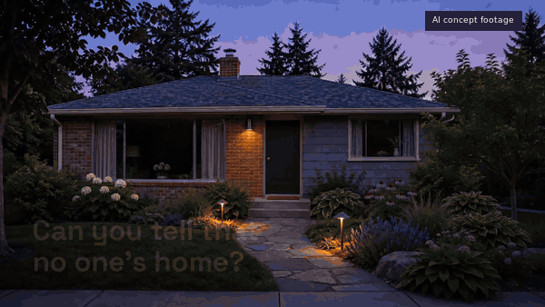

# Vacation Ghost

**Developer preview.** The Preview 2 simulator ran successfully on a Raspberry Pi 5. Physical testing is pending for the Shelly plugs and lamps, the optional LED and audio outputs, and automatic startup and trip recovery after a reboot. [Pi 5 test record](docs/hardware.md#raspberry-pi-5-simulator-test)

Vacation Ghost makes an empty house look lived-in while you’re away. A Raspberry Pi runs a local routine for two lamps, with optional TV-like glow from an LED strip and quiet household sounds from a USB audio setup. Evening activity starts near sunset, moves between rooms one lamp at a time, and winds down at a bedtime that varies each night. The Pi writes morning notes and a trip summary locally.

The first version takes manually entered trip dates. It uses no microphone or camera and collects no audio. The schedule and reports stay on the device. Other local applications can read the JSON reports.



## Try it without hardware

On Linux with Python 3.11 or later, run these commands from the checkout. The simulator uses Python’s standard library and your system’s time-zone database.

```sh
demo_dir=$(mktemp -d /tmp/vacation-ghost-demo.XXXXXX)
python3 -m vacation_ghost --config examples/vacation.example.toml simulate \
  --at 2030-06-11T09:00:00Z --state-dir "$demo_dir"
cat "$demo_dir/daily/2030-06-11.json"
```

The example uses a fictional June 10–13, 2030 trip in UTC. The simulation replays the trip up to `--at` and generates any reports due by that time. Omit `--at` to replay the whole trip and generate the final summary. Use a fresh temporary directory for each replay and keep device state in its own directory.

```sh
python3 -m unittest discover -s tests -v
```

## Set up the Raspberry Pi

A lights-only setup uses a Raspberry Pi Zero 2 W, Pi 4, or Pi 5 and two Shelly Gen2 or Gen3 plugs on the local network. See the [hardware guide](docs/hardware.md) for the parts list, optional glow and sound, and physical test checklist. The [systemd installation guide](docs/service.md) covers setting up the service to start at boot.

The service guide covers installing a verified release, checking both plugs with `doctor`, and trying the outputs with `rehearse`. Start with the lights-only Pi example and add glow or sound after the lamp checks pass. [Service guide](docs/service.md) · [Lights-only example](examples/vacation.lights-only.toml)

| Section | Settings |
| --- | --- |
| `[trip]` | Set `start` and `end` to ISO 8601 timestamps with UTC offsets. Use an IANA `timezone` such as `Etc/UTC` for the routine and the reports. |
| `[routine]` | List the kitchen lamp first and the living room lamp second in `rooms`. Set `sunset` from `15:00` to `22:00` and `bedtime` from `18:00` to `23:55` in local time, with sunset earlier than bedtime. If you supply `latitude` and `longitude`, the routine calculates sunset and uses `sunset` as a fallback. An optional `seed` controls the repeatable variation from day to day. |
| `[hardware]` | For glow, set `led_count` and the BCM `led_pin`. For sound, set `sounds_dir` (relative to the config or absolute) and `volume` up to `0.20`, starting low. For lights only, use `led_count = 0` and `volume = 0`. |
| `[hardware.plugs]` | Map each room to a different plug address. Use RFC 1918 IPv4 literals such as `http://192.168.1.40` or bracketed unique-local IPv6 literals such as `http://[fd00::40]`. |

At trip end, Vacation Ghost attempts to turn the outputs off and reports whether shutdown was confirmed. Use `disarm` to end the trip early and `recover` to retry a pending shutdown. Keep the original plug settings and state directory until shutdown is confirmed. Set and test each plug’s own auto-off and power-restore settings before leaving. [Service operator guide](docs/service.md#stop-recover-or-change-trips) · [Plug safeguards](docs/hardware.md#restrict-plug-access)

## Read reports locally

| File in the state directory | Purpose |
| --- | --- |
| `latest.json` | Current status, including `active`, `lamp_room`, the `updated_at` heartbeat, `shutdown_unconfirmed`, `faults_by_device`, and `device_faults`. The process replaces this file atomically. |
| `daily/YYYY-MM-DD.json` | Note due at 8 AM local time, named for its `delivery_date`. The `night_of` field is the previous evening’s date. If sunset was close to bedtime, `schedule_note` explains a shortened or skipped evening. |
| `trip.json` | End-of-trip summary in `message`, including shutdown status at publication. Check `latest.json` for the current status after a later recovery. |

The controller checks both lamps at each 15-second heartbeat. It turns off a relay that is on outside its scene and restores a lamp that unexpectedly went off if the schedule still calls for it. An audio or glow fault is reported in the device status while the lamps can continue running.

A local notification app can read the file for the current delivery date, use the stable `id` to send `message` once, and skip reports with `dry_run` set to `true`. It can read `trip.json` the same way. Both reports include a `schema_version` and `trip_id`. Export only the needed reports through a [read-only handoff](docs/service.md#share-reports-locally) and keep the controller’s state directory private.

If an existing published report is malformed, the controller saves a `.corrupt-*` copy and regenerates the report from trip activity using the same ID.

## Build and contribute

| Starting point | Contents |
| --- | --- |
| Git checkout | Application, tests, setup files, and the project website. Use this for the Pi service installation. |
| Source distribution (`.tar.gz`) | Application source, tests, hardware guides, service files, example configs, and the sound generator. |
| Wheel (`.whl`) | Linux `vacation-ghost` CLI and the MIT license. Use an example config from the source distribution or checkout. |

To install the Linux CLI from a checkout, run `python3 -m pip install .` in a virtual environment. For local development, put any private configuration or state under the ignored `.local/` directory and use fictional data in shared examples.

See [CONTRIBUTING.md](CONTRIBUTING.md) for the development workflow. Vacation Ghost is available under the [MIT License](LICENSE).

## Project website

From a Git checkout, run `python3 -m http.server --bind 127.0.0.1 --directory site 4173` and open `http://127.0.0.1:4173` on the same machine. The browser demo runs from the [site directory](site/).
