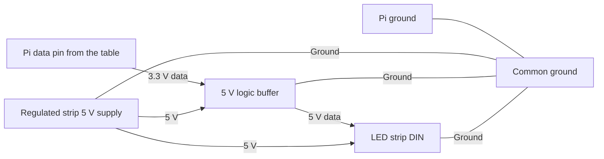

# Build a Vacation Ghost

Start with two switched lamps. Test your setup while you’re home before relying on it for a trip.

## Before buying

- **Check the plug model and firmware.** Look for a Shelly Gen2, Gen3, or Gen4 plug with local control on switch channel 0, a built-in auto-off timer, and the option to stay off when power returns. Match your outlet type and the lamp’s load. [Hardware compatibility](#hardware-compatibility)
- **Try the lamps you own.** Leave each lamp’s switch on, unplug it, then plug it back in. It should light up as soon as it gets power.
- **Check your network.** You’ll need to reserve two plug addresses and limit access to the Pi and trusted administrators. [Restrict plug access](#restrict-plug-access)

## Parts

| Quantity | Part | Notes |
| --- | --- | --- |
| 1 | Raspberry Pi Zero 2 W, Pi 4, or Pi 5 | For the lights-only setup. Use a compatible regulated Pi power supply, microSD card, and ventilated case. Run current Raspberry Pi OS with Python 3.11 or later. |
| 2 | Compatible Shelly Gen2, Gen3, or Gen4 plugs | Use two distinct devices. Reserve a different RFC 1918 IPv4 or unique-local IPv6 address for each plug. |
| 2 | Lamps | Reuse lamps that light when outlet power returns. Confirm they do so during rehearsal. |

Once the plugs are on your restricted local network, follow the [lights-only setup guide](service.md#lights-only-quick-start).

## Optional glow and sound

Add either option after the lamp checks pass.

Preview 2 uses the `rpi-ws281x` 5.0.0 PWM driver on Pi Zero 2 W and Pi 4. The Pi 5 driver on `main` uses SPI0 on the RP1 controller and is available for bench testing. Physical glow and blackout tests are pending. [Preview 2 driver](https://pypi.org/project/rpi-ws281x/5.0.0/) · [Pi 5 RP1 controller](https://github.com/raspberrypi/documentation/blob/fe7c672593752469d928e89f8d87d99bb6bc0a25/documentation/asciidoc/computers/io-controllers/rp1.adoc#L13-L51)

| Quantity | Part | Notes |
| --- | --- | --- |
| 1 | WS2812B-compatible 5 V GRB strip | Choose an 800 kHz strip. About 30 pixels is a starting point for a reflected glow. The Pi 5 development backend accepts up to 144 pixels. Follow the [wiring guide](#wire-the-optional-led-strip) for the data pin. |
| 1 each | 5 V strip power supply and 3.3 V-to-5 V logic level shifter | Choose a unidirectional logic buffer rated for the strip’s data rate, such as a 74AHCT125. Provide suitable low-voltage wiring and strain relief. |
| 1 each | USB audio adapter and powered speaker | For household sounds on Pi Zero 2 W, Pi 4, or Pi 5. The Pi Zero 2 W may need a USB OTG adapter or powered hub. A physical volume control makes quiet playback easier to set. |

Use the [Preview 2 glow and audio setup instructions](service.md#optional-tv-glow-and-sound) or the [Pi 5 glow bench instructions](service.md#try-pi-5-tv-glow-from-a-development-checkout).

## Restrict plug access

Use two plugs configured for unauthenticated local RPC. Put them on a trusted or separate IoT segment and restrict access with a firewall or VLAN ACL so only the Pi and trusted administrators can reach them. Apply the rule to traffic between clients as well as traffic between networks. Keep port forwarding and UPnP off. Disable the vendor cloud for local-only operation.

Reserve both plugs for Vacation Ghost. Disable their auto-on timers, stock schedules, actions, and any other home automation that switches them. Set each plug to restore power in the off state. Configure its built-in auto-off timer to outlast the longest planned single lamp session while limiting how long the lamp can stay on if the Pi loses power or network access. Confirm both safeguards independently of the Pi on your plug firmware.

## Hardware compatibility

| Setup | Intended compatibility | Verification |
| --- | --- | --- |
| Simulator | Linux with Python 3.11 or later and the IANA time-zone database | Covered by automated tests and a [Preview 2 run on a Raspberry Pi 5](#raspberry-pi-5-simulator-test). |
| Lights only | Pi Zero 2 W, Pi 4, or Pi 5 and two compatible Shelly Gen2, Gen3, or Gen4 plugs supporting local `Shelly.GetDeviceInfo` plus `Switch.GetStatus` and `Switch.Set` for channel 0 | Physical plug testing is pending. Complete the checklist on your Pi, plug models, and firmware. |
| TV glow in Preview 2 | Pi Zero 2 W or Pi 4, `rpi-ws281x` 5.0.0, PWM channel 0 on BCM GPIO18 | Complete the physical checklist on your Pi and OS image. |
| TV glow from `main` | Pi 5, Linux `spidev`, SPI0 MOSI on BCM GPIO10 (physical pin 19), up to 144 pixels | Automated tests cover frame encoding and blackout recovery. Physical glow and blackout tests are pending. [Bench rehearsal](service.md#try-pi-5-tv-glow-from-a-development-checkout) |
| Sound | Pi Zero 2 W, Pi 4, or Pi 5, ALSA `aplay`, a system-visible default USB audio device, and a powered speaker | Verify playback under the installed systemd unit. |

The **Shelly Plug US Gen4** (`S4PL-00116US`) is expected to work with the existing adapter over Wi-Fi. Verify auto-off and power-restore off independently of the Pi, then run `doctor` and `rehearse` with your exact model and firmware. [Shelly device profile](https://github.com/ALLTERCO/fleet-management/blob/6f1e3721b0958f5d6f75e71d43d317bba4fe1995/backend/src/devSimulation/profiles/gen4.ts#L198-L215) · [Physical checklist](#physical-release-checklist)

## Wire the optional LED strip

Disconnect both power supplies before wiring. The strip’s regulated 5 V supply powers the strip and logic buffer. Size the supply and wires to the strip’s rated maximum current. For example, 30 pixels rated at 60 mA each can draw 1.8 A. Follow the strip and buffer manufacturers’ wiring and protection guidance.

| LED driver | Pi data signal | Physical header pin |
| --- | --- | --- |
| Preview 2 PWM on Pi Zero 2 W or Pi 4 | BCM GPIO18 | 12 |
| Development SPI on Pi 5 | SPI0 MOSI, BCM GPIO10 | 19 |

For SPI, connect only MOSI as the data signal through the level shifter. Reserve all of SPI0 for the strip. It sees MOSI data sent to either chip select. [Raspberry Pi SPI pin mappings](https://www.raspberrypi.com/documentation/computers/raspberry-pi.html#spi-overview)

Power the Pi from its own supply. Share ground between the Pi, buffer, strip, and strip supply. Keep the 5 V output rails separate. A 74AHCT125 needs its selected channel’s output enable held low. Connect the buffer output to the strip’s input end, following the arrow on the strip. Keep all mains power inside enclosed, correctly rated supplies and smart plugs. Point the strip at curtains or a light-colored wall for an indirect glow.

Onboard PWM audio can conflict with Preview 2’s PWM LED driver. If it does, set `dtparam=audio=off` in `/boot/firmware/config.txt` on Raspberry Pi OS and reboot. Use a USB audio adapter with a [system-visible ALSA default](service.md#optional-tv-glow-and-sound) and test playback under the installed unit.

## Raspberry Pi 5 simulator test

A Preview 2 test used Raspberry Pi Imager on a MacBook Pro to write and verify Raspberry Pi OS (64-bit) on a CanaKit 128 GB microSD card. The CanaKit Raspberry Pi 5 booted from the card and was accessed from the MacBook Pro over SSH without a display.

The `v0.1.0-preview.2` simulator ran the example trip through the morning of June 11, 2030. The run produced the local JSON morning report for that date.

## Physical release checklist

Physical testing is pending for the Shelly plugs and lamps, the optional LED and audio outputs, and automatic startup and trip recovery after a reboot. Use this template to record a lights-only run on a Pi before relying on it for a trip. Keep local trip dates, addresses, device identifiers, and credentials out of shared reports. Share the release commit, models, firmware, and redacted observations.

| Bench record | Current record |
| --- | --- |
| Test date and release commit | Pending |
| Pi model and service profile | Pending. Begin with lights-only. |
| Raspberry Pi OS image and architecture, kernel and Python versions | Pending |
| Both plug models and firmware versions | Pending |
| LED strip, pixel count, GPIO, and driver version | Pending or not fitted |
| USB audio output and speaker | Pending or not fitted |

| Check | Physical observation | Controller status or report |
| --- | --- | --- |
| Verify each plug’s address, isolated access, auto-off time, and power-restore off independently of the Pi. | Pending | Pending |
| Cold-boot the Pi. Confirm accurate time before the service applies a scene, and run read-only `doctor` against both plugs. | Pending | Pending |
| Run `rehearse` with separate state and the scheduled unit stopped. Confirm one lamp at a time and check any optional outputs. | Pending | Pending |
| Start the actual unit for a future trip. Confirm a fresh, healthy idle status before enabling startup at boot. | Pending | Pending |
| Reboot the Pi during a short active trip. Observe the lamps during the interruption and confirm the schedule resumes after time synchronization. | Pending | Pending |
| Interrupt the local network or Pi power while a lamp is on. Record when the plug-side timer turns it off. Keep the scheduled unit stopped when testing `recover` after reconnection. Verify it only switches outputs off. | Pending | Pending |
| Disarm one test trip and let a separate test trip reach its scheduled end. Observe shutdown in both cases. Reboot after each and check that neither trip reactivates. | Pending | Pending |
| If fitted, test LED and audio output under the actual unit. Check strip color and blackout, and listen at the door or window. | Pending | Pending |
| Compare morning and final reports with observed activity. Check that a local reader can access only its intended exports. | Pending | Pending |
