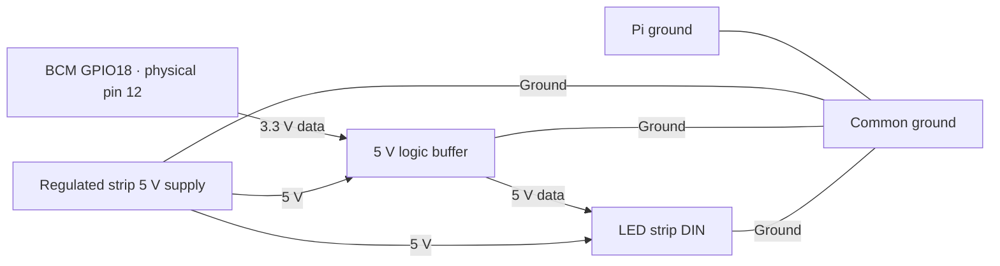

# Build a Vacation Ghost

Start with two switched lamps. The LED strip adds TV glow, and USB audio adds household sounds. Test each output while you’re home before relying on it for a trip.

## Parts

| Quantity | Part | Notes |
| --- | --- | --- |
| 1 | Raspberry Pi Zero 2 W or Pi 4 | With a compatible regulated Pi power supply, microSD card, and ventilated case. Use current Raspberry Pi OS with Python 3.11 or later. |
| 2 | Shelly Gen2 or Gen3 plugs | Two distinct devices with local `Shelly.GetDeviceInfo` and switch channel 0. Match your outlet type and the lamp’s load. Reserve a different RFC 1918 IPv4 or unique-local IPv6 address for each plug. |
| 2 | Lamps | Use lamps that light when outlet power returns. Confirm they do so during the rehearsal. |
| 1 | WS2812B-compatible 5 V GRB strip | Optional. Use an 800 kHz strip and BCM GPIO18 on physical header pin 12. About 30 pixels is a starting point for a reflected glow. |
| 1 each | 5 V strip power supply and 3.3 V-to-5 V logic level shifter | For the optional strip. Choose a unidirectional logic buffer rated for the strip’s data rate, such as a 74AHCT125. Provide suitable low-voltage wiring and strain relief. |
| 1 each | USB audio output and powered speaker | Optional. The Pi Zero 2 W may need a USB OTG adapter or powered hub. A physical volume control makes quiet playback easier to set. |

For a lights-only build, set up the Pi and two plugs and reuse your lamps and router. Once the plugs are on the local network, follow the [Pi setup guide](service.md#lights-only-quick-start).

## Restrict plug access

Use two plugs configured for unauthenticated local RPC. Put them on a trusted or separate IoT segment and restrict access with a firewall or VLAN ACL so only the Pi and trusted administrators can reach them. Apply the rule to traffic between clients as well as traffic between networks. Keep port forwarding and UPnP off. Disable the vendor cloud for local-only operation.

Reserve both plugs for Vacation Ghost. Disable their auto-on timers, stock schedules, actions, and any other home automation that switches them. Set each plug to restore power in the off state. Configure its built-in auto-off timer to outlast the longest planned single lamp session while limiting how long the lamp can stay on if the Pi loses power or network access. Confirm both safeguards independently of the Pi on your plug firmware.

## Hardware compatibility

| Setup | Intended compatibility | Verification |
| --- | --- | --- |
| Simulator | Linux with Python 3.11 or later and the IANA time-zone database | Covered by the cloud workflow and automated tests. |
| Lights | Two Shelly Gen2 or Gen3 plugs using local `Shelly.GetDeviceInfo`, `Switch.GetStatus`, and `Switch.Set` | Complete the physical checklist on your models and firmware. |
| TV glow | Raspberry Pi Zero 2 W or Pi 4 with `rpi_ws281x`, PWM channel 0 on BCM GPIO18, and a WS2812B-compatible GRB strip | Complete the physical checklist on your Pi and OS image. |
| Sound | ALSA `aplay`, a system-visible default USB audio device, and a powered speaker | Verify playback under the installed systemd unit. |

## Wire the optional LED strip

Disconnect both power supplies before wiring. The strip’s regulated 5 V supply powers the strip and logic buffer. Size the supply and wires to the strip’s rated maximum current. For example, 30 pixels rated at 60 mA each can draw 1.8 A. Follow the strip and buffer manufacturers’ wiring and protection guidance.

Power the Pi from its own supply. Share ground between the Pi, buffer, strip, and strip supply. Keep the 5 V output rails separate. A 74AHCT125 needs its selected channel’s output enable held low. Connect the buffer output to the strip’s input end, following the arrow on the strip. Keep all mains power inside enclosed, correctly rated supplies and smart plugs. Point the strip at curtains or a light-colored wall for an indirect glow.

Onboard PWM audio can conflict with the LED driver. If it does, set `dtparam=audio=off` in `/boot/firmware/config.txt` on Raspberry Pi OS and reboot. Use a USB audio adapter with a [system-visible ALSA default](service.md#optional-tv-glow-and-sound) and test playback under the installed unit.

## Physical release checklist

Physical tests are pending. Use this template to record an actual lights-only run on a Pi before relying on it for a trip. Keep local trip dates, addresses, device identifiers, and credentials out of shared reports. Share the release commit, models, firmware, and redacted observations.

| Bench record | Current record |
| --- | --- |
| Test date and release commit | Pending |
| Pi model and service profile | Pending. Begin with lights-only. |
| Raspberry Pi OS image and architecture, kernel and Python versions | Pending |
| Both plug models and firmware versions | Pending |
| LED strip, pixel count, GPIO, and driver version | Pending or not fitted |
| USB audio output and speaker | Pending or not fitted |

| Check | Physical observation | Controller status or report |
| --- | --- | --- |
| Verify each plug’s address, isolated access, auto-off time, and power-restore off independently of the Pi. | Pending | Pending |
| Cold-boot the Pi. Confirm accurate time before the service applies a scene, and run read-only `doctor` against both plugs. | Pending | Pending |
| Run `rehearse` with separate state and the scheduled unit stopped. Confirm one lamp at a time and check any optional outputs. | Pending | Pending |
| Start the actual unit for a future trip. Confirm a fresh, healthy idle status before enabling startup at boot. | Pending | Pending |
| Reboot the Pi during a short active trip. Observe the lamps during the interruption and confirm the schedule resumes after time synchronization. | Pending | Pending |
| Interrupt the local network or Pi power while a lamp is on. Record when the plug-side timer turns it off. Keep the scheduled unit stopped when testing `recover` after reconnection. Verify it only switches outputs off. | Pending | Pending |
| Disarm one test trip and let a separate test trip reach its scheduled end. Observe shutdown in both cases. Reboot after each and check that neither trip reactivates. | Pending | Pending |
| If fitted, test LED and audio output under the actual unit. Check strip color and blackout, and listen at the door or window. | Pending | Pending |
| Compare morning and final reports with observed activity. Check that a local reader can access only its intended exports. | Pending | Pending |
