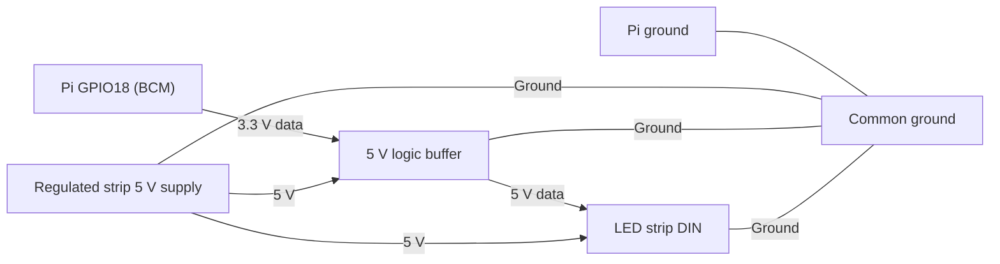

# Build a Vacation Ghost

Start with two switched lamps. The LED strip adds TV glow, and USB audio adds household sounds. Test each output while you’re home before relying on it for a trip.

## Parts

| Quantity | Part | Notes |
| --- | --- | --- |
| 1 | Raspberry Pi Zero 2 W or Pi 4 | With a compatible regulated Pi power supply, microSD card, and ventilated case. Use current Raspberry Pi OS with Python 3.11 or later. |
| 2 | Shelly Gen2 or Gen3 plugs | Must support local `Switch.GetStatus` and `Switch.Set` for channel 0. Match your outlet type and the lamp’s load. Reserve an RFC 1918 IPv4 or unique-local IPv6 address for each plug. |
| 2 | Lamps | Use lamps that light when outlet power returns. Confirm they do so during the rehearsal. |
| 1 | WS2812B-compatible 5 V RGB strip | Optional. About 30 pixels is a starting point for a reflected glow. GPIO18 is the default data pin. |
| 1 each | 5 V strip power supply and 3.3 V-to-5 V logic level shifter | For the optional strip. Choose a unidirectional logic buffer rated for the strip’s data rate, such as a 74AHCT125. Provide suitable low-voltage wiring and strain relief. |
| 1 each | USB audio output and powered speaker | Optional. The Pi Zero 2 W may need a USB OTG adapter or powered hub. A physical volume control makes quiet playback easier to set. |

The Pi, its power supply, and the two plugs are the first purchases for a lights-only build. Reuse the lamps and router you already have. Cost depends on regional plug prices and which parts you have on hand. Configure the plugs for local control and keep their RPC endpoints on the LAN.

## Restrict plug access

The plugs accept unauthenticated local RPC. Put them on a trusted or separate IoT segment and restrict access with a firewall or VLAN ACL so only the Pi and trusted administrators can reach the plugs. Apply the rule to traffic between clients as well as traffic between networks. Avoid port forwarding and UPnP exposure. Disable the vendor cloud on the plugs if you plan to control them only locally. The Pi needs no vendor cloud account to run the routine.

Set each plug to restore power in the off state. Configure its built-in auto-off timer to outlast a normal single lamp session while limiting how long the lamp can stay on if the Pi loses power or network access. Check both options on your exact firmware and confirm they work independently of the Pi. These plug-side safeguards matter even when the Pi reports that it issued an off command.

## Hardware compatibility

| Setup | Intended compatibility | Verification |
| --- | --- | --- |
| Simulator | Linux with Python 3.11 or later and the IANA time-zone database | Covered by the cloud workflow and automated tests. |
| Lights | Two Shelly Gen2 or Gen3 plugs using unauthenticated local RPC | Complete the physical checklist on your models and firmware. |
| TV glow | Raspberry Pi Zero 2 W or Pi 4 with `rpi_ws281x` PWM support and a WS2812B-compatible strip | Complete the physical checklist on your Pi and OS image. |
| Sound | ALSA `aplay`, a USB audio device, and a powered speaker | Verify playback under the same account as the service. |

## Wire the optional LED strip

Disconnect both power supplies before wiring. The strip’s regulated 5 V supply powers the strip and logic buffer. Size the supply and wires to the strip’s rated maximum current. For example, 30 pixels rated at 60 mA each can draw 1.8 A. Follow the strip and buffer manufacturers’ wiring and protection guidance.

Power the Pi from its own supply. Share ground between the Pi, buffer, strip, and strip supply. Keep the 5 V output rails separate. A 74AHCT125 needs its selected channel’s output enable held low. Connect the buffer output to the strip’s input end, following the arrow on the strip. Keep all mains power inside enclosed, correctly rated supplies and smart plugs. Point the strip at curtains or a light-colored wall for an indirect glow.

Onboard PWM audio can conflict with the LED driver. If it does, set `dtparam=audio=off` in `/boot/firmware/config.txt` on Raspberry Pi OS and reboot. Use the USB adapter for sound. Check the default ALSA output with `aplay -L` and test it under the account that will run Vacation Ghost.

## Physical release checklist

Physical tests are pending. The development environment has no Raspberry Pi, smart plugs, LED strip, or speaker connected. Use this record on the bench before relying on or calling a hardware profile verified.

| Bench record | Current record |
| --- | --- |
| Test date and release commit | Pending |
| Pi model and service profile | Pending |
| Raspberry Pi OS, kernel, and Python versions | Pending |
| Both plug models and firmware versions | Pending |
| LED strip, pixel count, GPIO, and driver version | Pending or not fitted |
| USB audio output and speaker | Pending or not fitted |

| Check | Current result |
| --- | --- |
| Stable plug addresses, network isolation, auto-off, and power-restore off. Verify these independently of the Pi. | Untested |
| Local `doctor` checks and accurate time and time zone. Check that a cold boot obtains correct time before the routine starts. | Untested |
| `rehearse` with the scheduled service stopped and a separate state directory. Check physical lamp exclusivity, indirect glow if fitted, and quiet audio at the door or window if fitted. | Untested |
| Short scheduled trip and early disarm. Check both lamps, glow, and sound turn off and the trip remains disarmed after reboot. | Untested |
| Pi reboot during an active trip. Check that the service picks up the current schedule, respects the trip cutoff, and shuts the outputs down. | Untested |
| Network or Pi power loss while a lamp is on. Record actual time to plug-side auto-off and confirm power-restore off. After reconnecting, test `recover` with the original state and verify no outputs activate. | Untested |
| Morning and end-of-trip reports reflect observed activity and the reader accesses only the intended exports. | Untested |
